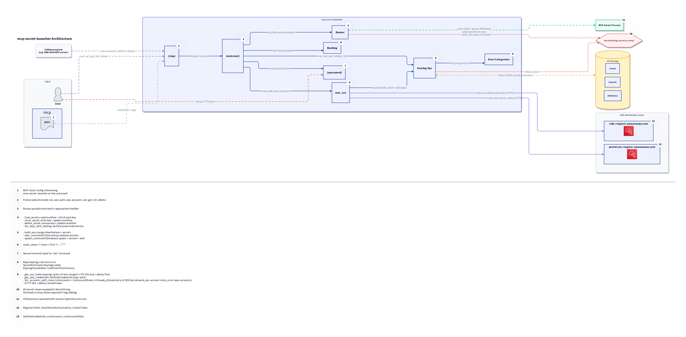

# Architecture

## Execution Flow

## AWS SSO (`aws-auth` and `aws-accounts`)

Both AWS subcommands live in `src/aws_sso.rs` and share one token path, `get_sso_token`:

1. Read the cached SSO access token from the keyring (`mcp-aws-sso` / `token:<sha256(sso_url)>`).
   Use it if more than 15 minutes of validity remain.
2. Otherwise take an exclusive file lock (`$TMPDIR/mcp-aws-sso-lock-<sha256(sso_url)>`), so
   concurrent launchers run at most one device flow, and re-check the cache.
3. Otherwise register (or reuse the cached) OIDC client, run the device authorization flow
   (prompts on stderr, browser opened in release builds), poll for the token, and cache it.

Then:

- `aws-auth` calls `GetRoleCredentials` and execs the target with the temporary credentials.
- `aws-accounts` calls `ListAccounts` and then `ListAccountRoles` per account (both
  paginated; roles fetched by up to 4 threads), and prints one JSON document on stdout. A
  repeated `nextToken` is treated as a portal bug and fails instead of looping.
- Portal requests (`portal_get`) retry HTTP 429, 5xx and network failures up to 7 attempts
  with full-jitter exponential backoff (250 ms base, 8 s cap), and honour `Retry-After`.
  401/403 are never retried. A final failure is a `PortalError` carrying the HTTP status,
  AWS error type and attempt count.
- The role listing is per account, not all-or-nothing: an account whose roles still fail is
  emitted with `"roles": []` and `"roles_error"`, the command exits 0, and stderr gets a
  one-line warning. Only a `ListAccounts` failure or a 401 fails the whole command. The
  SSO portal throttles per user, so many callers listing at once (for example several AI
  bots) were each failing on whichever account got throttled.

Any HTTP 401 from the portal deletes the cached token and asks the user to rerun. The token
is held in a `SecretString`, sent only in the `x-amz-sso_bearer_token` header, and never
printed. `aws-accounts` is meant to be run by other programs (for example an AWS shell MCP
server) to discover which accounts and roles a caller can ask for.

## Platform Support

| Platform | Keyring Backend | Exec Behavior |
|----------|----------------|---------------|
| Linux | libsecret / Secret Service D-Bus | `execvp` (launcher replaced) |
| macOS | Security.framework / Keychain | `execvp` (launcher replaced) |
| Windows | Credential Manager | Spawn + wait + propagate exit code |

Linux requires a running keyring daemon (e.g., `gnome-keyring-daemon`, KeePassXC). Headless environments like Docker need explicit daemon configuration.

## Security

- Secrets never touch disk, logs, or stdout (except masked via `get`)
- All secret values wrapped in `secrecy::SecretString` with zeroize-on-drop
- No temporary files created at any point
- `set` uses non-echoing terminal input — no `--value` flag exists
- On Windows, the env map is explicitly dropped/zeroized before waiting on the child process
- Known limitation: on Linux, `/proc/[pid]/environ` exposes env vars to same-uid or root for the lifetime of the child process. This is an accepted tradeoff vs persistent plaintext files.
